<picture><source media="(prefers-color-scheme: dark)" srcset="assets/hero-dark.svg"></picture>

<picture><source media="(prefers-color-scheme: dark)" srcset="assets/about-dark.svg"></picture>

<picture><source media="(prefers-color-scheme: dark)" srcset="assets/stack-dark.svg"></picture>

<a href="https://github.com/bitplugg/matesound"><picture><source media="(prefers-color-scheme: dark)" srcset="assets/project-matesound-dark.svg"></picture></a>&nbsp;<a href="https://github.com/bitplugg/rawui"><picture><source media="(prefers-color-scheme: dark)" srcset="assets/project-rawui-dark.svg"></picture></a>

<a href="https://github.com/bitplugg/ail0l"><picture><source media="(prefers-color-scheme: dark)" srcset="assets/project-ail0l-dark.svg"></picture></a>&nbsp;<a href="https://github.com/bitplugg/XDDbot"><picture><source media="(prefers-color-scheme: dark)" srcset="assets/project-xddbot-dark.svg"></picture></a>

<picture><source media="(prefers-color-scheme: dark)" srcset="assets/stats-dark.svg"></picture>

<picture><source media="(prefers-color-scheme: dark)" srcset="assets/streak-dark.svg"></picture>

<picture><source media="(prefers-color-scheme: dark)" srcset="assets/wave-dark.svg"></picture>

<a href="https://github.com/bitplugg?tab=repositories"><picture><source media="(prefers-color-scheme: dark)" srcset="assets/button-1-dark.svg"></picture></a>&nbsp;&nbsp;<a href="https://github.com/matesound"><picture><source media="(prefers-color-scheme: dark)" srcset="assets/button-2-dark.svg"></picture></a>

<a href="https://metawka.github.io/expressive-profile/?from=bitplugg"><picture><source media="(prefers-color-scheme: dark)" srcset="assets/credit-dark.svg"></picture></a>

